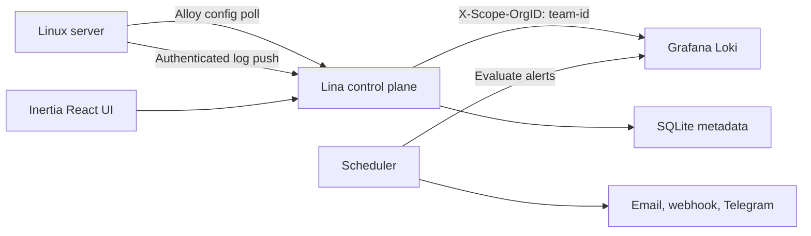

# Lina

Lina is a self-hosted log operations platform for Linux teams. It collects logs with Grafana Alloy, stores them in Grafana Loki, and gives operators one place to search streams, build dashboards, monitor agent health, and deliver alerts.


## Install on a fresh host

Point a domain at a 64-bit Linux host, open ports 80 and 443, then run:

```bash
curl -fsSL https://raw.githubusercontent.com/OthmanHaba/lina/main/install.sh | sudo bash -s -- --domain logs.example.com
```

Replace `logs.example.com` with your domain. The installer provisions Docker when needed, clones Lina into `/opt/lina`, creates production secrets, builds the application, migrates SQLite, starts Loki, and enables automatic HTTPS through Caddy.

For an HTTP-only installation on the detected IP:

```bash
curl -fsSL https://raw.githubusercontent.com/OthmanHaba/lina/main/install.sh | sudo bash -s -- --ip
```

The same command upgrades an existing installation. Lina keeps the existing application key and creates a timestamped SQLite backup before running migrations.

Full deployment requirements and options are in [Installation](docs/INSTALLATION.md).

## What Lina does

- Installs and manages Grafana Alloy agents on systemd-based Linux hosts
- Collects systemd, Docker, Nginx, host file, and container file logs
- Keeps teams isolated in both Laravel and Loki
- Searches merged streams through a focused log explorer
- Builds dashboards from timeseries, stat, log stream, alert, and server health widgets
- Detects threshold breaches and missing logs once per minute
- Notifies through email, webhooks, and Telegram
- Tracks agent polls, pushes, config sync, and daily ingest usage
- Applies team and per-server retention policies
- Supports owner, admin, and member roles with invitations
- Includes email verification, password recovery, and TOTP two-factor authentication

## How it works



The agent token identifies one server. Lina derives the team from that server, sets the Loki tenant header, and forwards the log payload without trusting tenant input from the agent or browser.

Read [Architecture](docs/ARCHITECTURE.md) for the request flows, data model, security boundaries, and service responsibilities.

## First use

1. Open the URL printed by the installer and register the first account.
2. Create or rename the team that will own the logs.
3. Open **Servers**, add a server, and copy its one-time install command.
4. Run that command as root on the Linux host you want to observe.
5. Add systemd, Docker, Nginx, file, or container log sources.
6. Use **Logs** to verify ingestion.
7. Configure notification channels and create alert rules.
8. Arrange dashboard widgets around the signals your team uses.

The complete workflow is documented in [User guide](docs/USER_GUIDE.md).

## Production stack

The one-command installation runs:

| Service | Responsibility |
| --- | --- |
| `app` | Laravel 13, Inertia v3, React 19, and Apache |
| `queue` | Database-backed Laravel queue worker |
| `scheduler` | Alert evaluation and scheduled maintenance |
| `loki` | Multi-tenant log storage and queries |
| `caddy` | HTTP routing and automatic HTTPS |

Persistent data stays in `/opt/lina/database`, `/opt/lina/storage`, and Docker volumes for Loki and Caddy.

## Local development

Requirements:

- PHP 8.4
- Composer 2
- Node.js 22 and npm
- Docker with Compose

Set up the application:

```bash
git clone https://github.com/OthmanHaba/lina.git
cd lina
composer setup
docker compose up -d
composer dev
```

Laravel Herd users can access the application at `https://lina.test`. The development Compose file only runs Loki; PHP and Vite run on the host.

## Quality checks

```bash
php artisan test --compact
npm run lint:check
npm run format:check
npm run types:check
npm run build
vendor/bin/phpstan analyse
```

## Configuration

Local defaults live in `.env.example`. Production values are created in `/opt/lina/.env.production`.

Important variables:

| Variable | Purpose |
| --- | --- |
| `APP_URL` | Public URL used in links and agent configuration |
| `LOKI_URL` | Internal Loki endpoint |
| `LOKI_INGEST_RPM` | Per-agent ingest request limit |
| `LOKI_OVERRIDES_PATH` | Runtime retention overrides file |
| `MAIL_*` | Email notification transport |
| `TELEGRAM_BOT_TOKEN` | Shared Telegram bot token |
| `LINA_SITE_ADDRESS` | Domain for Caddy, or `:80` in IP mode |

Never rotate `APP_KEY` on a running installation. It protects encrypted application data and sessions.

## Operations

Inspect the stack:

```bash
cd /opt/lina
docker compose -f docker-compose.production.yml ps
docker compose -f docker-compose.production.yml logs -f app scheduler queue
```

Run the original install command again to update. For backups, restore procedures, retention behavior, mail setup, and troubleshooting, read [Operations](docs/OPERATIONS.md).

## Documentation

- [Installation](docs/INSTALLATION.md)
- [User guide](docs/USER_GUIDE.md)
- [Architecture](docs/ARCHITECTURE.md)
- [Operations](docs/OPERATIONS.md)
- In-app documentation at `/docs`

## Technology

Laravel 13, Inertia v3, React 19, Tailwind CSS 4, SQLite, Grafana Loki, Grafana Alloy, Caddy, Pest 4, and Wayfinder.

## License

Lina is released under the MIT license declared in `composer.json`.
