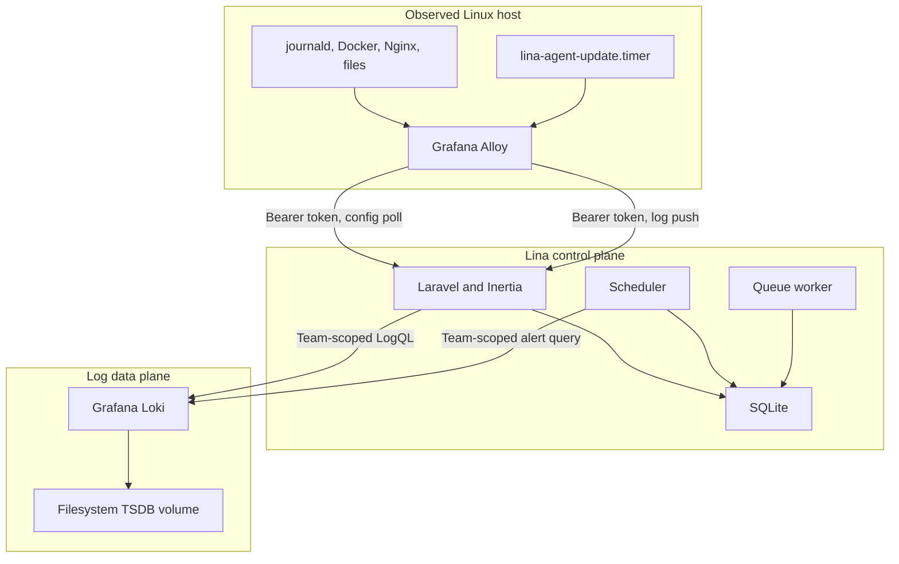
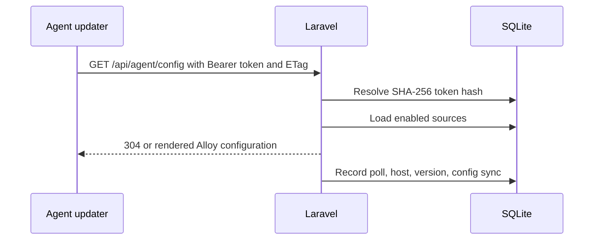
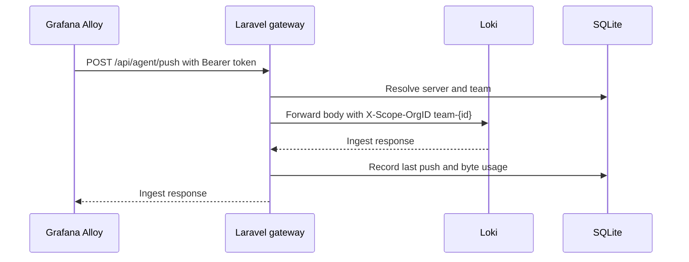
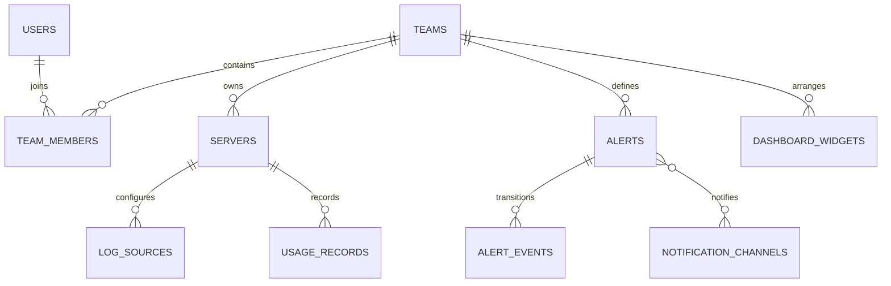

# Architecture

Lina is a self-hosted, multi-tenant log operations system. Laravel owns identity, configuration, authorization, queries, and alerts. Grafana Alloy runs on observed hosts. Grafana Loki stores log streams.

## System context

## Service responsibilities

### Laravel control plane

The Laravel application:

- Authenticates users through Fortify
- Manages teams, roles, invitations, and current-team context
- Creates servers and hashes agent tokens
- Renders complete Alloy configuration for each server
- Authenticates agent requests
- Adds the Loki organization header to ingested payloads
- Builds authorized LogQL for the explorer and dashboard
- Evaluates alerts and delivers state changes
- Writes Loki retention overrides
- Serves the Inertia React interface

### Grafana Alloy agent

Alloy runs on each observed host. A root-owned updater stores:

- `LINA_TOKEN`
- `LINA_BASE_URL`
- The current config ETag
- The managed `/etc/alloy/config.alloy`

The updater sends hostname and agent version headers when polling. A 304 response keeps the current configuration. A 200 response replaces the file and reloads Alloy.

All log labels are generated by Lina. An agent cannot invent a `server_id` label because the rendered configuration supplies the server ID and the token is bound to that same server.

### Grafana Loki

Loki runs with `auth_enabled: true` and uses the request's `X-Scope-OrgID` as its tenant. Data is stored in a single-node filesystem TSDB with schema v13.

The default retention period is 31 days. Lina writes per-team and per-server policies into a runtime override file mounted read-only into Loki.

### SQLite

SQLite stores:

- Users and Fortify security data
- Teams, memberships, and invitations
- Servers, health timestamps, and hashed tokens
- Log source definitions
- Daily usage records
- Alert rules, channels, and state events
- Dashboard widget definitions
- Database-backed sessions, cache entries, and queue jobs

It does not store log lines.

## Request flows

### Agent configuration

The `AuthenticateAgent` middleware resolves the token and places the server on the request. The config controller renders only that server's enabled sources.

### Log ingestion

The gateway does not accept a tenant ID from Alloy. It derives the team from the authenticated server. Per-agent rate limiting protects the endpoint.

### User log query

1. Web middleware authenticates the user and selects a current team.
2. The controller loads server IDs owned by that team.
3. Requested server IDs are intersected with the authorized set.
4. `LogQlBuilder` creates a selector for those IDs and source names.
5. Laravel calls Loki with `X-Scope-OrgID: team-{id}`.
6. Stream results are merged by nanosecond timestamp.
7. The browser receives normalized entries, not Loki credentials.

### Alert evaluation

The scheduler runs `alerts:evaluate` once per minute without overlap.

For each enabled alert:

1. Build the team and server-scoped selector.
2. Execute an instant `count_over_time` query against Loki.
3. Compare the result with the threshold or zero condition.
4. Persist `last_evaluated_at`.
5. When state changes, persist an `alert_event`.
6. Deliver the event to each enabled channel.

One channel failure does not stop evaluation or other channels. Consecutive failures are counted and a channel disables itself after ten.

## Tenancy and authorization

Lina uses the `Team` model as the tenant.

Application layer:

- Authenticated routes include the `{current_team}` prefix.
- `EnsureTeamMembership` verifies membership.
- Controllers scope records to `current_team_id`.
- Cross-team records return 404 to avoid revealing existence.
- Server selections are intersected with the active team's server IDs.

Storage layer:

- Every Loki write and query uses `team-{id}` as `X-Scope-OrgID`.
- That value comes from an authenticated server or user team.
- Browser and agent input cannot set the organization header.

Raw LogQL dashboard widgets remain tenant-scoped because the organization header, not the query text, defines the Loki tenant.

## Agent security

- Tokens contain 40 random characters.
- Only a SHA-256 hash is stored.
- Plaintext is shown only at creation or rotation.
- Rotation invalidates the previous token immediately.
- Agent config requests support ETags to reduce unnecessary reloads.
- The environment file containing the token is mode 600.
- The generated Alloy config is mode 644 because Alloy runs as an unprivileged service user.

## Retention model

Loki applies:

1. The global 31-day retention.
2. A team runtime override when Lina has a team policy.
3. A higher-priority stream retention selector for servers with an override.

Lina treats SQLite as the configuration source of truth. If writing the runtime file fails, the previous Loki configuration remains active and `php artisan loki:write-overrides` can repair it.

## Production topology

`docker-compose.production.yml` runs five services:

- `app`: Apache and PHP 8.4 serving Laravel
- `queue`: `php artisan queue:work`
- `scheduler`: `php artisan schedule:work`
- `loki`: Grafana Loki 3.4.2
- `caddy`: Caddy 2.10 reverse proxy and TLS

The app, queue, and scheduler use the same image and environment. Host bind mounts persist SQLite and Laravel storage. Named volumes persist Loki data and Caddy state.

## Frontend

The frontend uses:

- Inertia v3 for page responses and navigation
- React 19
- Wayfinder for typed Laravel routes
- Tailwind CSS 4 with the dark Graphite token system
- Radix primitives for accessible overlays and controls
- Recharts for dashboard and health visualizations

The app shell is persistent. Authenticated team routes use the sidebar layout. Public landing and documentation pages render without the application layout.

## Data model

Key relationships:

Refer to `database/migrations` for exact columns and constraints.
